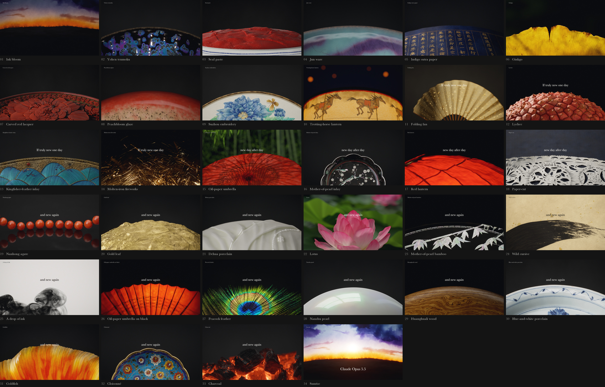

# Gewu 格物

The Claude Opus 5.5 launch film, in the art of the East. 33 seconds, 34 shots, one object or craft per shot. Every frame is rendered from code.

https://github.com/user-attachments/assets/a6cf2b35-e2d9-4244-a0e2-2b548e150a47

[Full quality](https://link1412.github.io/gewu/) · [High bitrate](https://github.com/link1412/gewu/releases/tag/film-1.0) · [中文](README.zh.md)

## How it's made

Python builds the geometry, materials, lights and motion of each shot. Blender Cycles path-traces them, a darkroom written for the film develops the linear frames, and `v2/film.py` cuts them together. A few motions come from solvers written for the film: a drop of ink from a 3D pseudo-spectral fluid, charcoal cracks from phase-field fracture, running glaze from a lubrication film.

Direction by link1412. Code and renders by Claude Opus 5.5.

## Read more

- [Render it yourself](docs/RENDER.md): every shot's command, how close each comes to the film, and what is still open
- [Tech stack](docs/STACK.md)
- [Shot by shot](docs/FILM.md)
- [Papers](docs/PAPERS.md)
- [Research reports](research/README.md)

## License

Code and text are [MIT](LICENSE). The film, poster and contact sheet in `docs/` are not under MIT, but repost them freely; there is no need to ask. Third-party material keeps its own terms: `v1/patches/` (pbrt-v4, Apache-2.0), `v2/fonts/` (OFL), `v2/music/NOTICE-MuseScore-General.md`, and what `research/` quotes.

An unofficial tribute. Claude is a trademark of Anthropic, and [the original film](https://x.com/claudeai/status/2102435511222890900) is theirs; none of its picture or sound is here.
