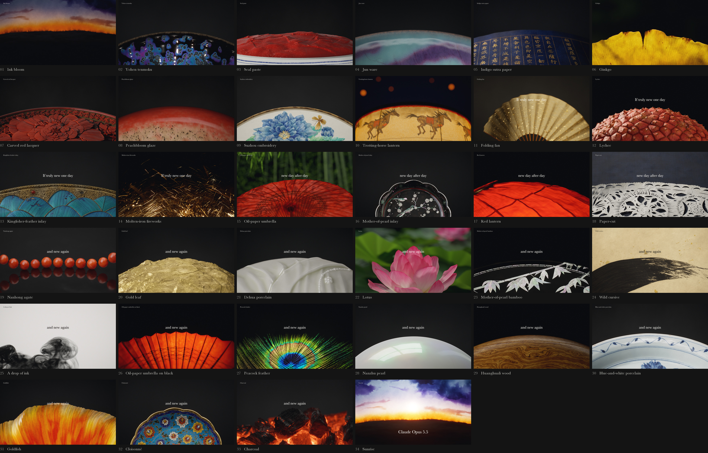

# 格物

Claude Opus 5.5 发布片的东方艺术版本。33 秒,34 镜,每镜一件东方器物或手艺。每一帧都由代码渲染。

https://github.com/user-attachments/assets/a6cf2b35-e2d9-4244-a0e2-2b548e150a47

[高清版](https://link1412.github.io/gewu/) · [高码率版](https://github.com/link1412/gewu/releases/tag/film-1.0) · [English](README.md)

## 怎么做的

几何、材质、灯光和运动写在 Python 里,Blender Cycles 路径追踪,线性帧进自写的暗房显影,再由 `v2/film.py` 合片。少数运动来自自写的解算器:一滴墨是 3D 伪谱流体,木炭的裂纹是相场断裂,流釉是润滑薄膜。

link1412 定方向和取舍。Claude Opus 5.5 写代码、做渲染。

## 延伸阅读

- [自己渲染](docs/RENDER.md):每镜的命令、和片子有多接近、还有什么没解决
- [技术栈](docs/STACK.md)
- [逐镜说明](docs/FILM.md)
- [论文索引](docs/PAPERS.md)
- [调研报告](research/README.md)

## 许可

代码和文字用 [MIT](LICENSE)。`docs/` 里的片子、海报和联系图不在 MIT 之内,可以随便转,不需要联系我们。第三方内容按各自的条款:`v1/patches/`(pbrt-v4,Apache-2.0)、`v2/fonts/`(OFL)、`v2/music/NOTICE-MuseScore-General.md`,以及 `research/` 引用的内容。

这是一部非官方的致敬作品。Claude 是 Anthropic 的商标,[原片](https://x.com/claudeai/status/2102435511222890900)属于 Anthropic,这里没有收录原片的画面或声音。
